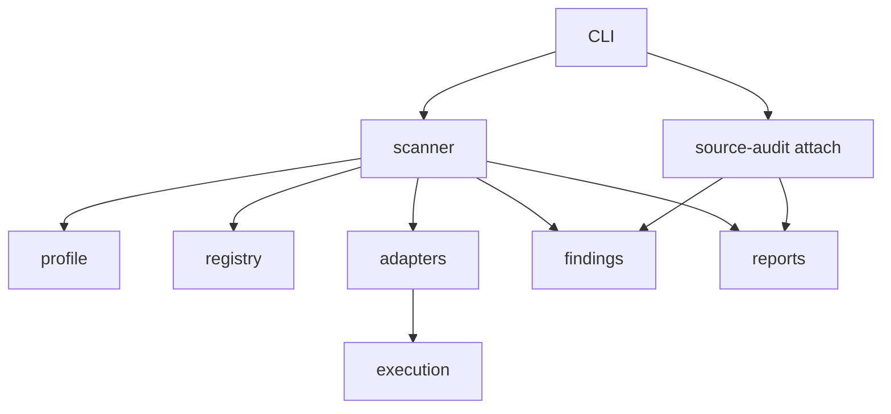

# Architecture

Security Scan is a local CLI. It profiles a repository, plans checks from a capability registry, runs adapters, normalizes findings, and writes one report directory. It does not host a service, queue, or database.

The README is the user entry point. This page is the module map.

## Modules

| Module | Responsibility |
|---|---|
| `src/cli.ts` | Commands, argument parsing, exit codes |
| `src/config.ts` | `.security-scan.json` schema and defaults |
| `src/profile.ts` | Canonical repository path, symlink checks, component detection |
| `src/registry.ts` | Capability definitions and plan decisions |
| `src/planner.ts` | Public plan entry; delegates to the registry |
| `src/scanner.ts` | Scan orchestration, git identity, exit code, raw-cache cleanup |
| `src/adapters.ts` | Trivy, Semgrep, Dart, and Gitleaks adapters and parsers |
| `src/execution.ts` | Host process spawn, timeout, environment allowlist, Compose |
| `src/findings.ts` | Canonical findings, redaction, fingerprints, dedupe |
| `src/reports.ts` | Manifest summary, Markdown, SARIF, staged report write |
| `src/doctor.ts` | Prerequisite report |
| `src/workflow.ts` | Workflow assessment model for deterministic vs full audit |
| `src/workflow-run.ts` | `workflow-run.json` state |
| `src/workflow-assess.ts` | Read a finished report and assess completeness |
| `src/source-audit/` | Cloudflare findings validation, import, identity, attach |

Dependency direction is inward toward `types.ts` and `findings.ts`. Adapters do not import the CLI. The source-audit attach path may read git through `readRepositoryGit`. The scanner does not import the attach module.

## Deterministic scan

1. Resolve the repository and reject escaping symlinks.
2. Load config. `policy.allowFailedTools: true` is a configuration error.
3. Profile components and build a plan. An empty plan is exit 3.
4. Record `git.commit` and `git.dirty` when git can be read.
5. Dispatch each planned tool. Required prerequisite failures are failed tool runs. Optional ones are skipped.
6. Deduplicate findings and write the report by staging a directory and renaming it.
7. Delete the scan-owned raw cache under `~/.cache/security-scan/<repo-hash>/<scan-id>`. Historical `security-reports/` directories stay.

`security-scan scan` does not launch an agent.

## Agent skill lifecycle

The Cloudflare source audit is a separate skill. Its lifecycle in this CLI is only:

1. An operator or agent produces a findings file outside the CLI.
2. `audit validate` checks the vendored schema.
3. `audit import` prints what would be imported and does not write the report.
4. `audit attach` merges importable records when identity checks pass.

`workflow register-cloudflare` records what the operator says happened. Registration is not evidence that a process ran. `workflow assess` compares that record with the manifest and does not upgrade a missing hunt into a completed audit.

## Fail closed

| Condition | Result |
|---|---|
| Required scanner cannot run | Tool `failed`, scan `incomplete`, exit 2 |
| Semgrep `PartialParsing` with usable rows | Findings kept, tool `failed`, exit 2 |
| Blocking Semgrep errors or unusable JSON | That tool contributes no findings |
| Optional Dart or Gitleaks skip | Scan can still complete |
| Config, path, or audit identity error | Exit 3, report unchanged on attach |
| Unexpected orchestration throw | Exit 4 |

Exit 0 is a completed scan whose findings are below the fail threshold. Exit 1 is a completed scan with findings at or above that threshold. Neither exit code means comprehensive coverage.
